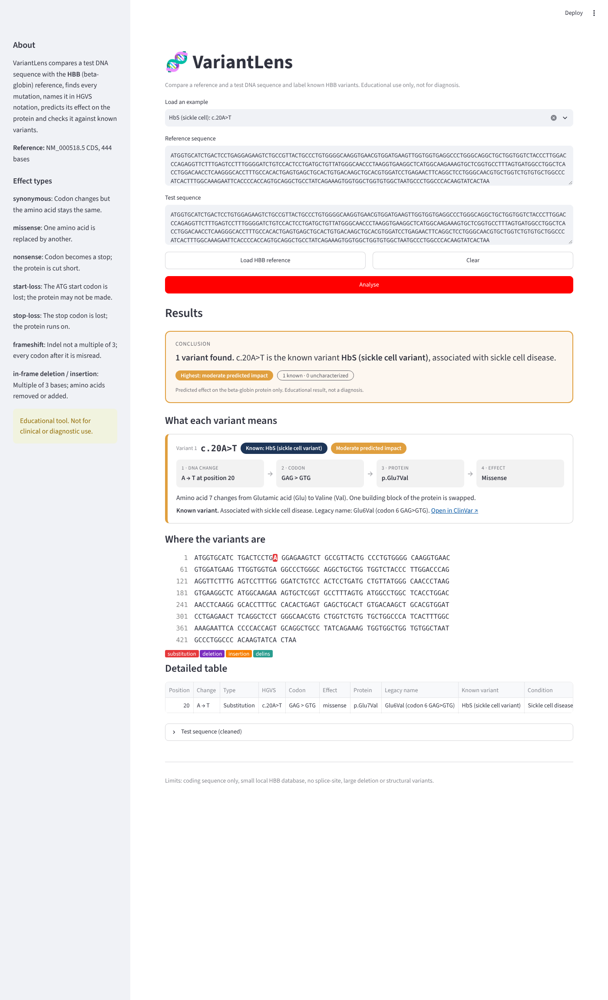

# VariantLens

**A simple DNA mutation analyzer for the HBB (beta-globin) gene.** Paste a DNA sequence, and VariantLens finds every mutation, names it in standard HGVS notation, predicts its effect on the protein, and checks it against a database of known sickle cell and thalassemia variants.



> **Educational tool only. Not for clinical or diagnostic use.**

## Why this project

One changed base in the HBB gene causes sickle cell disease (c.20A>T, the HbS mutation). Other HBB mutations cause beta-thalassemia and HbE disease, which are common in India, including West Bengal. VariantLens shows how a single DNA change leads to a changed protein and a disease.

## Features

- Accepts plain DNA or FASTA input and rejects invalid characters with a clear message
- Detects substitutions, insertions and deletions, using global alignment when lengths differ
- Names each variant in HGVS notation (c.20A>T, c.126_129del, c.27dup), shifting indels to the 3'-most position as HGVS requires
- Predicts the effect: synonymous, missense, nonsense, start-loss, stop-loss, frameshift, in-frame deletion/insertion
- Shows the codon change, protein change (p.Glu7Val, p.Phe42Leufs) and legacy haemoglobin name (Glu6Val)
- Matches against 7 verified known variants and links to ClinVar
- Shows a plain-language **Conclusion** and one result card per variant (DNA change → codon → protein → effect, predicted impact, known or uncharacterized)
- Highlights changes on the sequence with position numbers (red = substitution, purple = deletion, orange = insertion)
- 13 built-in example sequences for demonstration

## Installation and running

Requires Python 3.10 or newer.

```bash
python -m venv venv
venv\Scripts\activate            # Windows
source venv/bin/activate         # Mac/Linux
pip install -r requirements.txt
streamlit run app.py
```

The app opens in your browser at http://localhost:8501.

**Run the tests:**

```bash
pytest -v                            # 63 tests: core logic, data and app
python tests/make_results_table.py   # regenerates results_table.md
```

## How it works

```
Input > Validate > Compare / Align > Variant events > HGVS name > Consequence > Database match > Highlight + table
```

1. **Validate:** `clean()` strips FASTA headers and spaces and allows only A, C, G, T.
2. **Compare:** equal lengths are compared base by base; different lengths go through global pairwise alignment (Biopython `PairwiseAligner`), so an indel does not shift every later position.
3. **Normalize and name:** `normalize_indel()` shifts an indel in a repeat to its 3'-most equivalent position, then `to_hgvs()` writes the HGVS c. name. Positions equal c. numbers because the reference starts at the A of ATG.
4. **Consequence:** `annotate()` translates the normal and mutated protein and finds the first changed amino acid, giving the effect, the p. name and the legacy name.
5. **Match:** `lookup()` checks the name and its aliases against `data/hbb_variants.json`.

## Project structure

```
variantlens/
  app.py                     Streamlit interface
  core.py                    validation, alignment, normalization, naming, consequence, lookup
  data/hbb_cds.txt           HBB CDS reference, NM_000518.5 (444 bases)
  data/hbb_variants.json     known-variant database
  tests/test_core.py         core and data tests
  tests/test_app.py          clicks every example in the app
  tests/make_results_table.py
  results_table.md           results table for the report
  DATA_NOTES.md              how the reference and database were verified
  DEMO_SCRIPT.md             five-minute demo plan
  screenshots/
```

## Database sources

Each variant was verified on **27 October 2026** against the reference sequence and against ClinVar, LOVD and HbVar. See `DATA_NOTES.md` for the full log.

| Variant | Known as | Protein | Condition |
|---|---|---|---|
| c.20A>T | HbS | p.Glu7Val | Sickle cell disease |
| c.19G>A | HbC | p.Glu7Lys | HbC disease |
| c.79G>A | HbE | p.Glu27Lys | HbE / HbE-beta-thalassemia |
| c.118C>T | Codon 39 | p.Gln40Ter | Beta-zero thalassemia |
| c.47G>A | Codon 15 | p.Trp16Ter | Beta-zero thalassemia |
| c.126_129del | Codon 41/42 (-TTCT) | frameshift | Beta-zero thalassemia |
| c.27dup | Codon 8/9 (+G) | frameshift | Beta-zero thalassemia |

## Limitations

- **Educational only.** Real diagnosis uses blood counts, HPLC or electrophoresis, and clinical genetic testing.
- **Coding sequence only.** Splice-site, promoter and intron variants (such as IVS-I-5) are not covered.
- **No large rearrangements** or copy-number changes.
- **Small database.** A variant not in the table is "uncharacterized", which is not the same as harmless.
- **Simplified protein names** for in-frame insertions and delins, and frameshift names give only the first changed amino acid (p.Phe42Leufs, not p.Phe42LeufsTer19).

## Future work

- Full HGVS protein names for frameshifts (with the new stop position)
- Genomic HBB reference to detect splice variants
- Live ClinVar lookup with local fallback
- CSV/PDF export and a quiz mode for students

## Team

| Member | Role |
|---|---|
| A | Data and testing: reference, database, tests, results table, merging |
| B | Core engine: validation, alignment, variant calling, 3' normalization, HGVS |
| C | Biology and annotation: genetic code, consequence, legacy names, lookup |
| D | Interface and delivery: Streamlit app, highlighting, README, demo |
